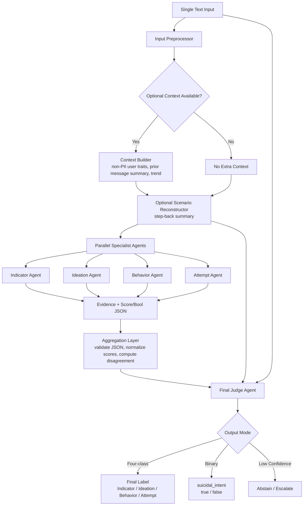
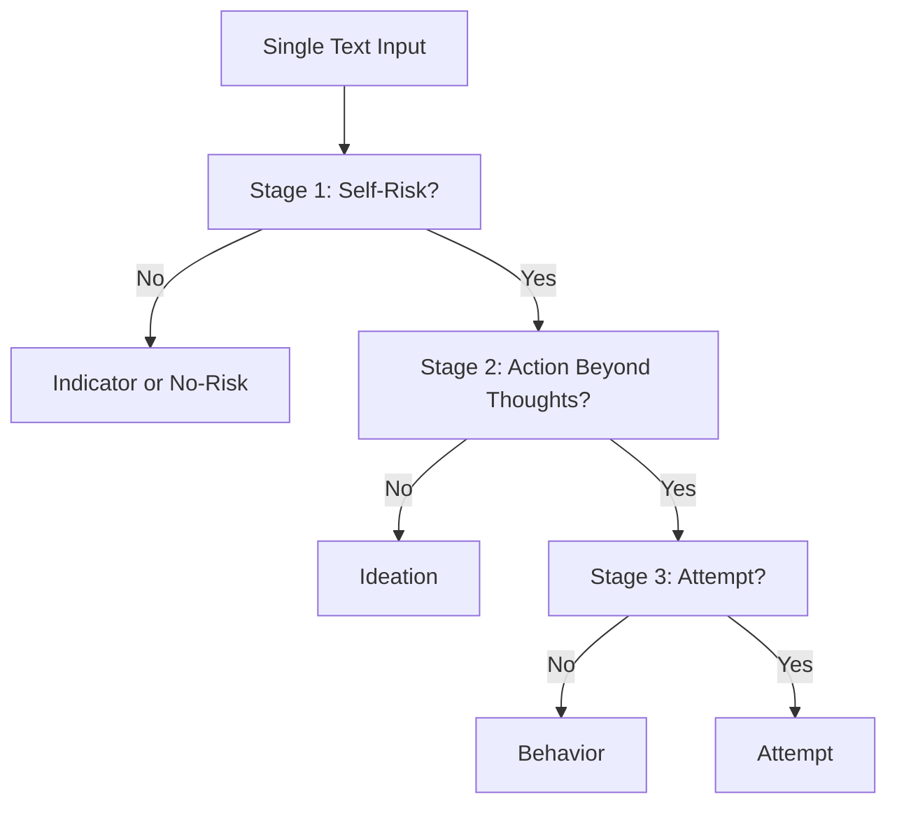

# Multi-Agent Suicide Risk Classification Architecture

## Purpose

Design a multi-agent classifier that takes one text input and returns one final output:

- a four-class label: `Indicator`, `Ideation`, `Behavior`, or `Attempt`
- or a binary screening label: `suicidal_intent = true/false`

The goal is research evaluation, not clinical deployment. The design should be compared against:

1. a rule-based keyword baseline
2. the existing single-agent LLM baseline
3. alternative multi-agent workflows, including a hierarchical decision tree

## Core Hypothesis

The current single-prompt baseline asks one model to understand all four label definitions at once. This may amplify label-boundary confusion, especially between `Indicator` and `Ideation`, and may weaken recall for urgent classes such as `Behavior` and `Attempt`.

The proposed system decomposes the task:

- each specialist agent focuses on one label only
- the final judge receives all specialist outputs and makes the final decision
- optional context reconstruction and user-history modules can help the specialists reason from a clearer scenario

## High-Level System Architecture



## Components

### 1. Input Preprocessor

Responsibilities:

- accept a single text input
- preserve the original text unchanged
- attach optional metadata when available
- reject empty or invalid inputs

Input object:

```json
{
  "sample_id": "string",
  "text": "string",
  "optional_context": {
    "prior_messages_summary": "string",
    "non_pii_user_context": "string",
    "observed_trend": "improving | worsening | stable | unknown"
  }
}
```

The optional context should not contain direct PII. Useful context could include stable writing patterns, recurring themes, recent escalation, or whether the user has shifted from abstract discussion to self-directed statements.

### 2. Scenario Reconstructor

Optional two-stage module before classification.

Purpose:

- reconstruct the complete situation before label classification
- identify who is at risk
- distinguish self-risk from discussion about another person
- summarize actions, plans, means, past attempts, and temporal cues

This is similar to a step-back prompt. It should not assign the final label. It should produce a compact scenario summary that all specialist agents receive.

Output schema:

```json
{
  "scenario_summary": "string",
  "subject_of_risk": "self | other_person | general_discussion | unclear",
  "risk_evidence": ["string"],
  "protective_or_deescalating_evidence": ["string"],
  "time_context": "current | past | hypothetical | unclear",
  "ambiguities": ["string"]
}
```

Why test this:

- It may reduce `Indicator` versus `Ideation` confusion.
- It may help specialist agents reason from the same interpretation of the text.
- It creates a traceable intermediate artifact for error analysis.

### 3. Specialist Agents

Four agents run in parallel. Each receives:

- original text
- optional context summary
- optional reconstructed scenario
- only one target-label definition

Each agent answers one question:

> Does this text match my assigned label?

Specialists:

- `IndicatorAgent`
- `IdeationAgent`
- `BehaviorAgent`
- `AttemptAgent`

### 4. Specialist Output Options

Two output formats should be tested.

#### Option A: Numerical Score With Reasoning

Each specialist returns a score from 0 to 100.

```json
{
  "target_label": "Ideation",
  "score": 0,
  "is_match": false,
  "confidence": 0,
  "reasoning": "Brief evidence-based rationale.",
  "supporting_evidence": ["quoted or paraphrased evidence"],
  "contradicting_evidence": ["evidence against this label"],
  "uncertainty": "string"
}
```

Use this when the final judge needs graded evidence, ambiguity, and confidence.

#### Option B: Binary Yes/No

Each specialist returns a strict boolean.

```json
{
  "target_label": "Attempt",
  "is_match": false,
  "confidence": 0,
  "reasoning": "Brief evidence-based rationale.",
  "supporting_evidence": [],
  "uncertainty": "string"
}
```

Use this to test whether simpler binary subtasks outperform score-based subtasks.

### 5. Aggregation Layer

The aggregation layer is deterministic code, not an LLM.

Responsibilities:

- validate each specialist JSON output
- normalize scores to a common scale
- detect missing or malformed specialist results
- compute disagreement features for the final judge
- optionally apply deterministic fallback rules

Derived fields:

```json
{
  "max_score_label": "Ideation",
  "max_score": 82,
  "second_score_label": "Behavior",
  "second_score": 76,
  "score_margin": 6,
  "positive_specialists": ["Ideation", "Behavior"],
  "urgent_score": 76,
  "urgent_flag": true,
  "disagreement_level": "low | medium | high"
}
```

### 6. Final Judge Agent

The judge receives:

- original text
- optional user/context information
- optional reconstructed scenario
- all specialist outputs
- aggregation features

The judge returns either the final four-class label or binary suicidal-intent decision.

Four-class output schema:

```json
{
  "final_label": "Ideation",
  "confidence": 0.0,
  "rationale": "string",
  "evidence_used": ["string"],
  "why_not_other_labels": {
    "Indicator": "string",
    "Behavior": "string",
    "Attempt": "string"
  },
  "urgent_action_group": false,
  "abstain": false
}
```

Binary output schema:

```json
{
  "suicidal_intent": true,
  "confidence": 0.0,
  "rationale": "string",
  "evidence_used": ["string"],
  "abstain": false
}
```

The judge should prioritize recall for urgent cases when evidence supports `Behavior` or `Attempt`.

## Procedural Workflow

### Workflow A: Four-Agent Judge, Score-Based

1. Receive one text input.
2. Preprocess and attach optional non-PII context.
3. Optionally run the scenario reconstructor.
4. Send the same text and scenario summary to four specialist agents in parallel.
5. Each specialist returns a JSON score, reasoning, evidence, and uncertainty for its label.
6. Aggregation layer validates outputs and computes score margins/disagreement.
7. Final judge reviews the original text, scenario summary, specialist outputs, and aggregate features.
8. Final judge returns exactly one label.
9. Persist full trace: original text ID, scenario, specialist outputs, aggregate features, final label, confidence, and token/cost telemetry.

### Workflow B: Four-Agent Judge, Binary Specialist Output

1. Receive one text input.
2. Optionally reconstruct the scenario.
3. Send the text to four parallel binary specialists.
4. Each specialist answers `is_match: true/false` for one label.
5. Aggregation layer counts positive labels and disagreement.
6. Final judge resolves conflicts:
   - no positive labels: likely `Indicator` or binary `suicidal_intent = false`
   - exactly one positive label: select that label unless judge finds contradiction
   - multiple positive labels: choose the most specific/highest-risk label supported by evidence
7. Persist the decision trace.

### Workflow C: Hierarchical Decision Tree

This is the main alternative design from the meeting notes.



Decision stages:

1. `self_risk_agent`: Is the author talking about their own suicidal risk?
2. `action_agent`: Is there behavior/preparation/self-harm beyond thoughts?
3. `attempt_agent`: Is there a current or past suicide attempt?

This can output the same four labels, but it avoids asking one model to compare all labels at once.

## Final Label Rules

The final judge should use these label boundaries:

- `Indicator`: no author self-risk; discussion of someone else, general topic, or denial of personal suicidality
- `Ideation`: author expresses suicidal thoughts or desire to die without concrete self-harm action
- `Behavior`: author describes preparatory or self-harm behavior beyond thoughts
- `Attempt`: author mentions a current or past suicide attempt

If a true negative/no-risk class is added later, separate it from `Indicator`:

- `No-Risk`: no suicide-related content or no clinically relevant risk content
- `Indicator`: suicide-related content, but not the author's own self-risk

## Handling Context And History

When context exists, add a context builder before classification.

Useful context:

- prior message summary
- recurring themes
- escalation/de-escalation trend
- whether the user recently shifted from third-person/general discussion to self-directed statements
- whether prior messages contained planning, means, or past attempts

Avoid:

- direct PII
- unnecessary demographic inference
- treating personality/context as stronger evidence than the current text

Trend output:

```json
{
  "trend": "improving | worsening | stable | unknown",
  "trend_evidence": ["string"],
  "current_message_shift": "higher_risk | lower_risk | unchanged | unclear"
}
```

## Evaluation Plan

Compare these systems on the same dataset split:

1. rule-based keyword baseline
2. single-agent four-label baseline
3. four-agent score-based specialists plus judge
4. four-agent binary specialists plus judge
5. scenario reconstruction plus four-agent judge
6. hierarchical decision-tree design
7. binary suicidal-intent screening mode

Report:

- accuracy
- macro F1
- per-class precision, recall, F1
- recall for `Behavior`
- recall for `Attempt`
- recall for urgent-action group: `Behavior + Attempt`
- false-negative rate for urgent-action group
- abstention rate, if confidence thresholding is used
- cost and latency per sample

## Additional Ideas To Test

### 1. Disagreement-Based Escalation

If specialists disagree strongly or top scores are close, the judge can abstain or escalate to a stronger model.

Escalation triggers:

- score margin below threshold
- `Behavior` or `Attempt` score high but final judge wants lower-risk label
- malformed specialist output
- high uncertainty from two or more specialists

### 2. Recall-Prioritized Judge

Create a judge prompt variant that explicitly prioritizes urgent-case recall. Compare it with a neutral judge prompt.

Goal:

- reduce missed `Behavior` and `Attempt` cases
- measure tradeoff in false positives

### 3. Calibrated Thresholds

Use validation data to choose thresholds for:

- specialist score positivity
- final judge confidence
- urgent-action escalation
- abstention

This is stronger than choosing thresholds by intuition.

### 4. Adversarial Hard Negatives

Add negative cases that mention distress, sadness, or general suicide topics without author self-risk.

Purpose:

- test whether the model over-flags ordinary distress
- separate `No-Risk` from `Indicator`
- make the system more realistic for screening

### 5. Evidence Consistency Check

Add a lightweight verifier that checks whether each specialist's reasoning cites evidence that actually appears in the text or scenario summary.

Purpose:

- reduce unsupported reasoning
- improve auditability
- make final judge inputs cleaner

## Implementation Notes For This Repo

The current code already has partial support for this direction:

- `multi-agent-host` mode in `src/example/suicide_detection/llm_agent.py`
- reusable orchestration in `src/EvalRing/agent/multi_role.py`
- `per-class-score` mode, which already asks one class-specific question per label

Recommended implementation path:

1. Add a new explicit mode, for example `specialist-judge`.
2. Reuse the `OpenAIAgent` client and `AgentResponse` contract.
3. Implement four label-specialist prompts with strict JSON schemas.
4. Add a deterministic aggregation object before the judge.
5. Add optional scenario reconstruction as a separate switch, for example `--use-scenario-reconstruction`.
6. Persist all intermediate outputs in `all_cases.csv` or a sidecar JSONL file so errors can be audited.
7. Add tests for JSON parsing, label normalization, tie handling, and fallback behavior.

## Open Design Questions

1. Should the specialist agents use numerical scores or binary yes/no outputs by default?
2. Should `Indicator` mean "no self-risk but suicide-related," or should a separate `No-Risk` label be introduced immediately?
3. Should the final judge be allowed to abstain, or must it always output one label for benchmark comparability?
4. Should severe-risk recall be prioritized even if macro F1 decreases?
5. Should the scenario reconstructor be used for every sample or only when specialist disagreement is high?
