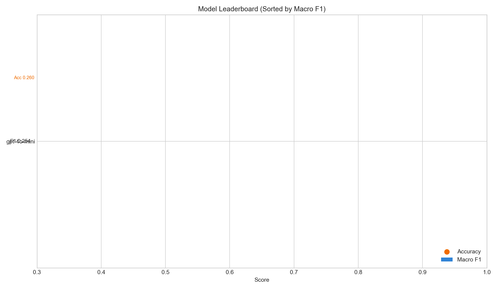
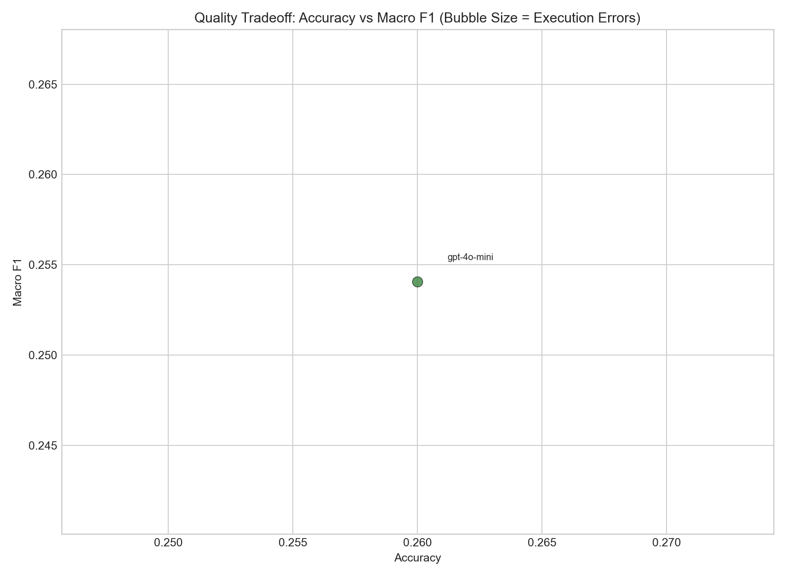
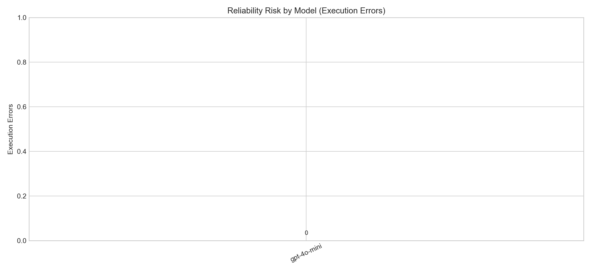
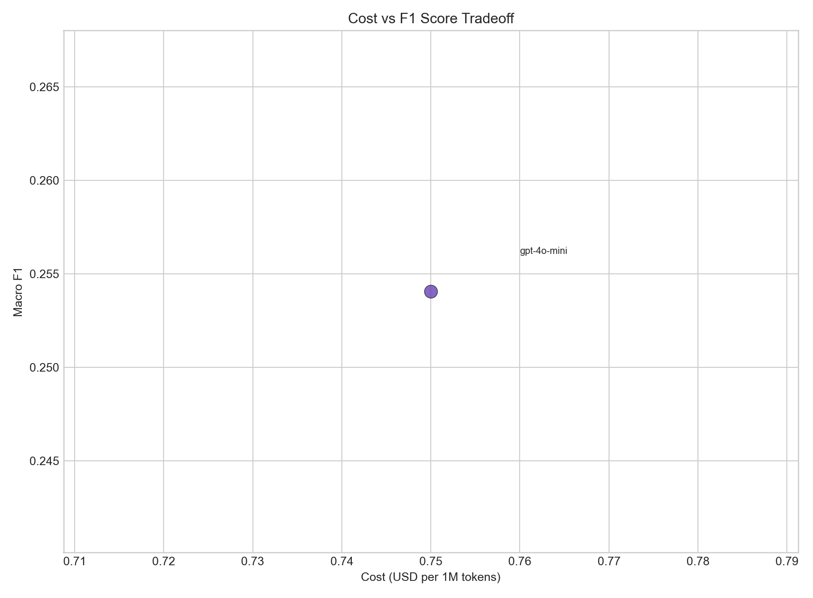
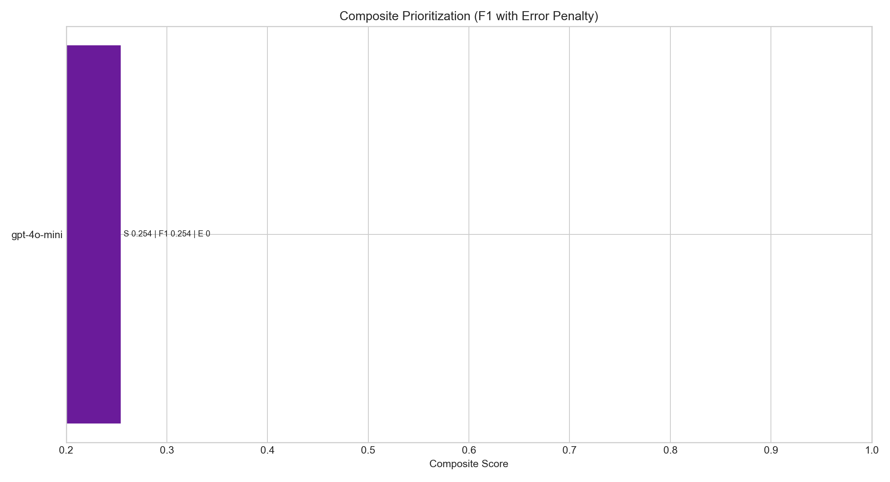

# Run Suite Visual Pack

Generated from `suite_report_20260716_223325.json`.

## Key Takeaways

- Best Macro F1: **openai/gpt-4o-mini** (0.2541)
- Best Accuracy: **openai/gpt-4o-mini** (0.2600)
- Highest reliability risk (execution errors): **openai/gpt-4o-mini** (0)

## Charts

### 1) Leaderboard by Macro F1 + Accuracy

### 2) Accuracy vs Macro F1 (Bubble Size = Errors)

### 3) Execution Error Risk

### 4) Cost vs F1 Tradeoff

### 5) Composite Prioritization

